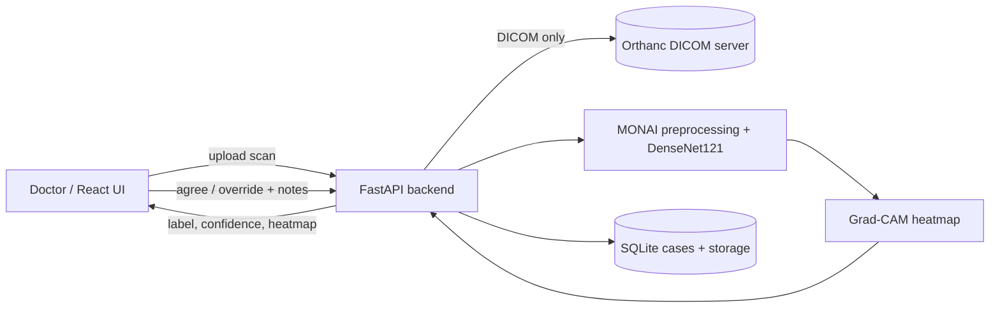

# AI-Assisted Medical Imaging and Diagnosis System

A web platform where a chest scan (PNG, JPG or DICOM) is uploaded, classified by a deep learning model,
explained with a Grad-CAM heatmap, and then reviewed by a doctor who can agree with or override the AI.

> Research prototype. Not a medical device and not for clinical use.

## Architecture



| Part | Tech |
|---|---|
| Preprocessing, augmentation | MONAI transforms |
| Model | PyTorch, DenseNet121 fine-tuned from ImageNet |
| Explainability | Grad-CAM (implemented in `backend/common.py`) |
| DICOM | pydicom for reading, Orthanc for storage |
| Data / model versioning | DVC (`dvc.yaml`) |
| API | FastAPI + SQLite |
| UI | React (Vite) |
| Deployment | Docker Compose (backend, frontend, Orthanc) |

## Project layout

```
backend/    app.py (API), common.py (model, Grad-CAM, DICOM), train.py, make_demo_data.py
frontend/   React app
models/     model.pth + metrics.json (created by train.py)
data/       datasets (not committed, tracked with DVC)
docker-compose.yml, dvc.yaml
```

## 1. Setup

```bash
python -m venv .venv
# Windows: .venv\Scripts\activate      Mac/Linux: source .venv/bin/activate
pip install -r backend/requirements.txt
```

## 2. Data

Download the Kaggle dataset **Chest X-Ray Images (Pneumonia)** and place it so you have:

```
data/chest_xray/train/{NORMAL,PNEUMONIA}/
data/chest_xray/test/{NORMAL,PNEUMONIA}/
```

(If the zip creates `chest_xray/chest_xray/`, move the inner folder up one level.)

No dataset yet? Generate synthetic images to test the pipeline (not medical data):

```bash
python backend/make_demo_data.py          # creates data/demo
```

## 3. Train

```bash
python backend/train.py --data data/chest_xray --epochs 5
# CPU only? use a subset:   python backend/train.py --data data/chest_xray --epochs 3 --limit 400
# smoke test:               python backend/train.py --data data/demo --epochs 3
```

Writes `models/model.pth` and `models/metrics.json` (accuracy, AUC, confusion matrix, per-class report).
Training on a free Kaggle or Colab GPU is much faster than a laptop CPU.

## 4. Run locally

```bash
# terminal 1 - backend
cd backend
uvicorn app:app --reload --port 8000

# terminal 2 - frontend
cd frontend
npm install
npm run dev          # http://localhost:5173
```

API docs: http://localhost:8000/docs

## 5. Run with Docker (backend + frontend + Orthanc)

```bash
docker compose up --build
```

- UI: http://localhost:5173
- API: http://localhost:8000/docs
- Orthanc: http://localhost:8042 (uploaded DICOM files appear here)

`models/` and `storage/` are mounted, so train first and the container will pick up `models/model.pth`.

## 6. DVC

```bash
dvc init
dvc add data/chest_xray
git add data/chest_xray.dvc data/.gitignore .dvc
dvc repro            # re-runs training when code or data change
```

## API summary

| Method | Path | Purpose |
|---|---|---|
| POST | `/predict` | Upload a scan, get label, confidence, heatmap |
| GET | `/cases` | List cases |
| GET | `/cases/{id}/image`, `/cases/{id}/heatmap` | Scan and Grad-CAM overlay |
| POST | `/cases/{id}/review` | Doctor decision: agree or override, with notes |

## Results

Fill in after training (copy from `models/metrics.json`):

| Metric | Value |
|---|---|
| Test accuracy | |
| Test AUC | |
| Pneumonia recall | |

## Limitations and future work

- Only chest X-ray classification is trained. CT and MRI volumes can be uploaded as DICOM (middle slice is used), but there is no model trained for them.
- The Kaggle dataset is small and from one source, so results will not generalise to other hospitals.
- Add user login, an audit log, and 3D MONAI models for CT/MRI.
